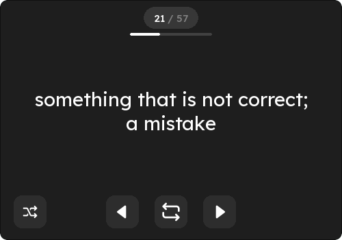

a simple flashcard app built with python and pygame.

## features

- flip cards to see definitions
- shuffle the deck
- navigate between cards
- multiple definitions for a single word
- progress counter

## screenshots

<div align="center">
  
  
</div>

## installation

clone the repository:

```bash
git clone https://github.com/FinTheDev/pwntbook.git
cd pwntbook
```

install the dependencies:

```bash
pip install -r requirements.txt
```

run pwntbook:

```bash
python main.py
```

## controls

| key | action |
|---|---|
| `SPACE` | flip |
| `CTRL + SPACE` | shuffle |
| `LEFT` | previous card |
| `RIGHT` | next card |
| `ESC` | quit |

## card format

you can add your own flashcards by editing `assets/cards.json`.

example:

```json
[
    {
        "word": "example",
        "definition": "a thing characteristic of its kind or illustrating a general rule"
    }
]
```

multiple definitions are also supported:

```json
[
    {
        "word": "example",
        "definition": [
            "a thing characteristic of its kind",
            "something used to illustrate a rule"
        ]
    }
]
```

## built with

- python
- pygame-ce
- pyconify
- cairosvg

## license

this project is licensed under the MIT License. see [LICENSE](LICENSE) for details.
