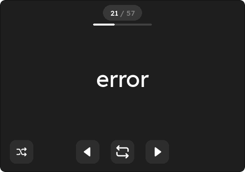

a simple flashcard app made with python and pygame.

decided to make my own instead of using someone else's app.

## features

- flip cards to see definitions
- shuffle the deck
- navigate between cards
- multiple definitions for a single word
- progress counter
- jump to any card using the progress counter
- animated progress indicator

## screenshots

<div align="center">
    
    
</div>

## controls

| key | action |
|---|---|
| `SPACE` | flip |
| `CTRL + SPACE` | shuffle |
| `LEFT` | previous card |
| `RIGHT` | next card |
| `ENTER` | jump to entered card number |
| `BACKSPACE` | delete input |
| `ESC` | cancel counter editing / quit app |

you can click the progress counter to enter a card number and jump directly to it.

## setup

clone the repo:

```bash
git clone https://github.com/FinTheDev/pwntbook.git
cd pwntbook
```

install dependencies:

```bash
pip install -r requirements.txt
```

run:

```bash
python main.py
```

## adding cards

cards are stored in `assets/cards.json`.

example:

```json
{
    "word": "word goes here",
    "def": "definition goes here"
}
```

multiple definitions are supported:

```json
{
    "word": "word goes here",
    "def": [
        {
            "type": "n.",
            "meaning": "definition goes here"
        },
        {
            "type": "v.",
            "meaning": "another definition"
        }
    ]
}
```

## built with

- python
- pygame
- cairosvg
- pyconify
- lexend deca

## status

still working on it. more features coming soon.
